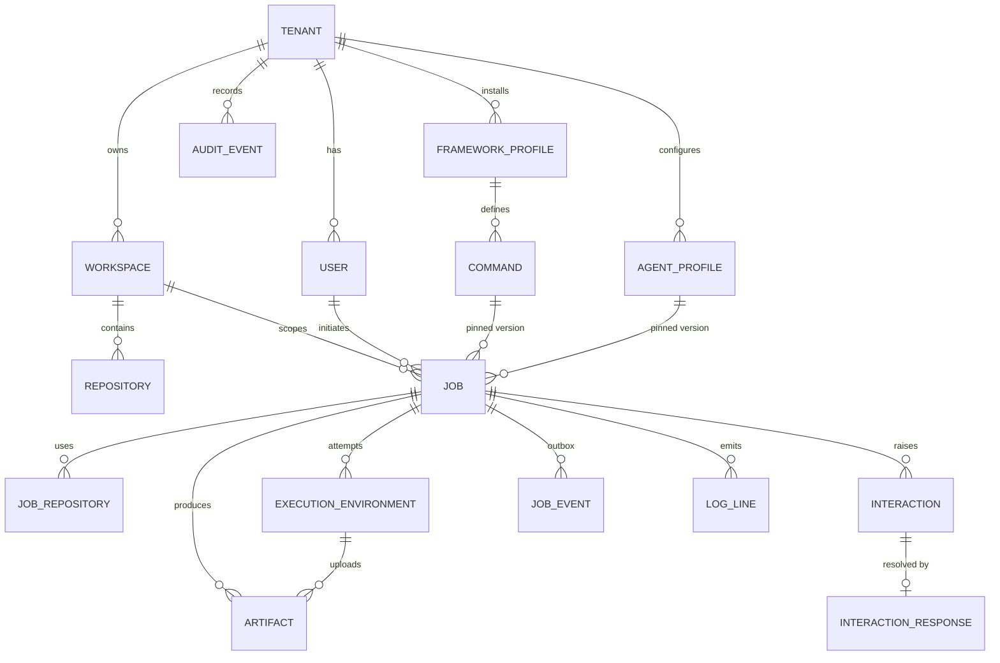

# Domain model

> Source of truth: [`internal/domain/model.go`](../../internal/domain/model.go),
> [`internal/registry/command.go`](../../internal/registry/command.go), and the
> schema in [`internal/store/migrations`](../../internal/store/migrations).

Every row carries `tenantId`, and every query is tenant-scoped.

## Entities

### Tenant
An isolation boundary (organization). Has **quotas**
(`maxConcurrentJobs` default 10, `maxQueuedJobs`,
`maxSubmissionsPerUserPerMinute`), `retentionDays` (default 90),
`permittedProviders` (pool allow-list), and an optional security policy.

### User
An identity within a tenant: `subject` from the IdP, email, display name,
and **roles** (`business_analyst`, `architect`, `developer`, `qa_engineer`,
`release_engineer`, `platform_admin`, `viewer`). Roles map to permissions in
`internal/authz` ([ADR-0009](../adr/0009-identity-and-authorization.md)).

### Workspace
The context a job runs in.

- **Type:** `SINGLE_REPOSITORY`, `MULTI_REPOSITORY`, `MANAGED`, `EPHEMERAL`, or
  `CUSTOM`.
- **Lifecycle mode:** `EPHEMERAL_CHECKOUT` or `PERSISTENT`.
- **Data classification:** `PUBLIC` < `INTERNAL` < `CONFIDENTIAL` <
  `RESTRICTED`. This limits which pools may run its jobs.
- **Defaults:** agent profile, framework, and provider (`AUTO` or a pool).
- **Allow-lists:** permitted agent profiles and pools.

### Repository
A Git repository attached to a workspace.

- **Provider:** `GITHUB`, `GITLAB`, or `GIT`.
- **URL:** `https`, or `file` in development only.
- **Credential:** `credentialRef`, a reference into the secret manager, never
  the secret itself. Embedded credentials in URLs are rejected.
- **Checkout:** default branch, checkout policy, permitted operations
  (`read`, `write`), optional pinned revision.

### AgentProfile (versioned)
How to run one agent CLI:

- **Adapter and CLI:** adapter `provider` (`mock`, later `claude-code`,
  `copilot-cli`), CLI name and pinned version, runtime image, auth method.
- **Behaviour:** interaction mode, environment, default args.
- **Limits:** resources (CPU/memory/ephemeral storage), execution policy.

Saving creates a new **version**. Jobs pin `agentProfileVersion`.

### FrameworkProfile
An SDLC framework installation (for example `sdd-default`): source,
**revision** (pinned per job), discovery strategy, compatible agents, and
required tools.

### Command (versioned, metadata-driven)
One framework slash command, for example `/write-spec` or `/Plan-migrate`
(exact casing):

- **Classification:** phase and personas.
- **Inputs:** typed input fields.
- **Effects:** repository access (`NONE`/`READ`/`WRITE`), required
  permissions, expected artifacts, side effects.
- **Policies:** timeout, approval policy (`beforeExecution`, approver role,
  production approval), retry policy, HITL policy (`maxWaitSeconds`,
  `onTimeout`), output validation rules.
- **Lifecycle:** status (approved / pending). Jobs pin the command version.

See [ADR-0007](../adr/0007-metadata-driven-command-registry.md).

### Job
One execution of one command in one workspace by one user. Records:

- **What was asked:** command and version, inputs, repositories, agent
  profile and version, framework revision, requested pool.
- **Where it ran:** the selected pool.
- **Where it is:** `state`, `currentStep`, `attempt`, `pendingOutcome`.
- **How it ended:** `failureClass` and `failureMessage` (first failure wins),
  `cleanupStatus`.
- **Lineage:** `retryOf` (new job on retry), `parentJobId`, `links`.
- **Timestamps.**

The workflow is the only writer of `state`; see the
[state machine](state-machine.md).

### JobRepository
Per-job repository binding:

- **Before the run:** requested revision.
- **During the run:** **resolved commit** (reproducibility), checkout path,
  working branch for `WRITE` commands.
- **After the run:** final commit and change-request URL.

### ExecutionEnvironment
One **attempt**, unique per `(jobId, attempt)`:

- **Placement:** provider/pool and provider reference.
- **Progress:** status (`PROVISIONING` … `COMPLETED`/`FAILED`/`TERMINATED`/
  `LOST`/`SUSPENDED`), interaction mode.
- **Outcome:** exit code, result status, summary, error, failure class.
- **HITL links:** pending interaction, checkpoint artifact, resume
  interaction.
- **Lifecycle:** cleanup status/error, `expiresAt`.
- **Auth:** a hashed **per-execution token** with expiry and revocation.

### Interaction and InteractionResponse
A durable question or approval.

- **Kind:** `CLARIFICATION`, `MULTIPLE_CHOICE`, `FREE_TEXT`,
  `MISSING_INPUT`, `APPROVAL`, `PERMISSION`, `TOOL_AUTHORIZATION`,
  `ARTIFACT_REVIEW`, or `CONFLICT_RESOLUTION`.
- **Content:** prompt, options, input schema (`required`, `min`/`maxLength`,
  `multiple`).
- **Target:** requested user and/or role.
- **Status and timing:** status (`RECORDED` → `OPEN` → `RESOLVED`/`EXPIRED`/
  `CANCELLED`), expiry.

A response carries a decision (`ANSWER`, `APPROVE`, or `REJECT`), values or
text, a comment, and the responder. It is stored idempotently per
`Idempotency-Key`. Platform approval gates use `executionId = ""`.

### Artifact
An output file: type (for example `specification`, `task-list`,
`changes.diff`, `checkpoint`), name, content type, size, **SHA-256**,
classification (`USER` is downloadable; `INTERNAL`, such as checkpoints, is
never served), source step, repository and revision, and retention. The
content lives in object storage ([ADR-0011](../adr/0011-artifact-storage.md)).

### JobEvent (outbox)
Monotonic `id`, `type`, JSON `payload`. Written in the same transaction as
the change it describes and streamed over SSE
([ADR-0003](../adr/0003-events-outbox-and-sse.md)).

### LogLine
Redacted, size-limited log output per execution (`stdout`, `stderr`,
`supervisor`), sequence-numbered for paging.

### AuditEvent
Append-only record of security-relevant actions: actor and actor type,
action (for example `job.submit`, `job.cancel`, `interaction.respond`,
`interaction.approve`, `artifact.download`, `repository.add`,
`workspace.create`, `agent_profile.save`, `job.operator.retry`), target, and
non-secret details.

## Invariants

1. A job's `state` changes only through legal transitions, applied by its
   workflow.
2. At most one execution attempt is active per job at a time.
3. An interaction becomes `OPEN` only after the job is in a waiting state.
4. A response is accepted only for an `OPEN` interaction, from an authorized
   responder, and only after validation.
5. Secrets are never stored in job inputs, logs, events, artifacts, or audit
   details. Redaction runs inside the execution environment, and credential
   references point into the secret manager.
6. Cross-tenant access returns *not found*.
