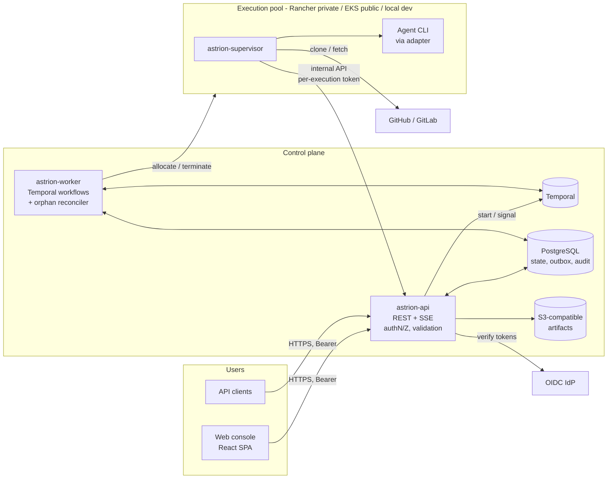

# Architecture overview

Astrion is a modular, cloud-native control plane that runs AI coding agents
(Claude Code, GitHub Copilot CLI, and future CLIs) through the SDLC phases
**Plan → Design → Implement → Test → Deploy → Maintain**. Each run happens in
an isolated, ephemeral execution environment, with durable human-in-the-loop
questions and approvals.

Related documents:

- [Domain model](domain-model.md)
- [Job state machine](state-machine.md)
- [Architecture decision records](../adr/README.md)
- [Threat model](../security/threat-model.md)
- [Public API (OpenAPI)](../../api/openapi.yaml) and [internal execution API](../../api/execution-api.yaml)

## Components and boundaries



| Component | Responsibility | Trust |
|---|---|---|
| **Web console** (`web/`) | Personas run commands, follow jobs live, answer questions, download artifacts | Untrusted client; server enforces everything |
| **astrion-api** (`cmd/astrion-api`) | Public REST API `/api/v1`, SSE, durable job acceptance, idempotency, interaction responses, audit. Also the **internal execution API** `/internal/v1` for supervisors | Trusted; holds DB and object-store credentials |
| **astrion-worker** (`cmd/astrion-worker`) | One Temporal workflow per job: validation (including policy-based pool selection), approval gates, admission, provisioning, monitoring, HITL waits, cleanup. Also runs the start dispatcher (every 5 s) and the orphan reconciler (every minute) | Trusted; holds provider credentials |
| **astrion-supervisor** (`cmd/astrion-supervisor`) | Entry point inside each execution environment: checkout, run the agent, redact and stream logs, upload artifacts, relay questions | **Untrusted zone**; holds only a per-execution token and job-scoped secrets |
| **Agent adapters** (`internal/agent`) | Translate one CLI into a neutral contract ([ADR-0004](../adr/0004-capability-based-agent-adapters.md)) | Run inside the execution environment |
| **Execution providers** (`internal/provider`) | Kubernetes (Rancher, EKS) and local (dev only) ([ADR-0005](../adr/0005-execution-providers-and-pools.md)) | Called only by the worker |

Every arrow that crosses a boundary has a defined contract. The public API
is specified in OpenAPI; the internal API is narrow and token-scoped; the
provider and adapter interfaces are Go interfaces with tests.

## Lifecycle of a job

```mermaid
sequenceDiagram
    autonumber
    actor U as User
    participant API as astrion-api
    participant PG as PostgreSQL
    participant T as Temporal / worker
    participant P as Provider
    participant S as Supervisor + agent

    U->>API: POST /api/v1/jobs (Idempotency-Key)
    API->>API: authorize, validate command, inputs, repositories, requested pool
    API->>PG: insert job (SUBMITTED) + outbox event, one transaction
    API->>T: start workflow job-<id> (best effort; worker dispatcher retries)
    API-->>U: 202 {id}
    U->>API: GET /jobs/{id}/events (SSE)
    T->>PG: VALIDATING (re-validate, select pool by policy)
    T->>PG: QUEUED (wait for capacity) → PROVISIONING
    T->>P: Allocate(environment, owner labels, secrets)
    P->>S: start supervisor
    S->>API: GET /internal/v1/executions/{id}/spec
    S->>S: checkout repos, run agent
    S->>API: status / logs (redacted) / artifacts
    S->>API: POST interactions (agent question)
    API->>PG: interaction RECORDED
    S->>API: complete (SUSPENDED, checkpoint)
    T->>P: release environment (checkpoint/resume mode)
    T->>PG: WAITING_FOR_INPUT, interaction OPEN → users notified
    U->>API: POST /interactions/{id}/responses
    API->>PG: validate, authorize, store, audit
    API->>T: nudge
    T->>P: provision attempt 2 (resume from checkpoint)
    S->>API: artifacts + complete (COMPLETED)
    T->>PG: COLLECTING_ARTIFACTS → CLEANING_UP
    T->>P: Terminate; revoke token; release capacity
    T->>PG: SUCCEEDED + job.completed
    API-->>U: SSE end
```

## Deployment topology

| Environment | Control plane | Execution | Notes |
|---|---|---|---|
| **Local development** | API + worker as local processes; `temporal server start-dev`; local PostgreSQL | `local` provider: supervisor as a local process group (no isolation) | Mock agent; filesystem artifacts; dev tokens. See the [getting-started guides](../getting-started/) |
| **Private (Rancher)** | Kubernetes Deployments (API ×N, worker ×N), managed PostgreSQL, Temporal cluster, S3-compatible storage | Kubernetes pool `network: PRIVATE` on the Rancher cluster | Holds `CONFIDENTIAL`/`RESTRICTED` workspaces |
| **Public (AWS EKS)** | Same | Kubernetes pool `network: PUBLIC` on EKS | Only workspaces at or below the pool's `maxClassification` |

Production mode (`ASTRION_ENV=production`) refuses development shortcuts at
startup:

- static dev tokens;
- the `local` provider;
- the filesystem artifact store;
- demo seeding;
- `insecureSkipVerify` on Kubernetes pools.

It also rejects `file://` repository URLs when they are added (`422`).

## Repository layout

```
cmd/
  astrion-api/         public + internal HTTP API
  astrion-worker/      Temporal worker + orphan reconciler
  astrion-supervisor/  in-environment supervisor
  mock-agent/          deterministic agent CLI for dev/CI
internal/
  domain/              entities, state machine, roles, errors (no infra deps)
  api/                 HTTP handlers, SSE, internal execution API
  workflow/            job workflow + activities
  orchestrator/        Temporal client facade used by the API
  store/               PostgreSQL persistence + migrations
  registry/            framework/command metadata (defaults/sdd-default.json)
  agent/               adapter contract (+ mock adapter)
  provider/            provider contract, pools/selection, kubernetes, local
  supervisor/          supervisor runtime (checkout, logs, artifacts)
  execapi/             client for the internal execution API
  procgroup/           cross-platform process-tree control
  reconciler/          orphan environment reconciliation
  auth/, authz/        authentication (OIDC, dev) and authorization
  events/              outbox notification broker (pg_notify)
  objectstore/         S3 + filesystem artifact stores
  redact/              secret redaction
  bootstrap/, config/, temporalx/
web/                   React + TypeScript + Vite + Tailwind console
api/                   OpenAPI specifications
docs/                  ADRs, architecture, security, plan, guides
deploy/                (Release 1 hardening) Dockerfiles, Helm chart
```
