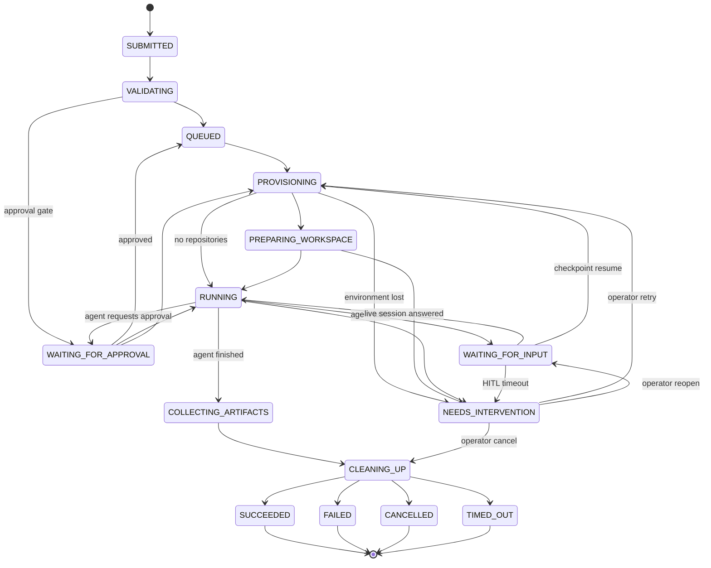

# Job state machine

> Source of truth: [`internal/domain/jobstate.go`](../../internal/domain/jobstate.go).
> This document explains that code. The transition table below is checked
> against the code by `TestStateMachineDocMatchesCode`, so the two cannot drift.

A **job** is one user request to run one framework command (for example
`/write-spec`) against a workspace. Its state is the *business* view of the
lifecycle that users, the API, and policies observe. The authoritative
*execution history* (timers, retries, signals) lives in the Temporal workflow
for that job; see [ADR-0002](../adr/0002-temporal-workflow-per-job.md).

## Rules

1. **The workflow is the only writer of job state.** The API and the
   supervisor record *facts* (a status report, a question, an answer, a cancel
   request) and nudge the workflow. The workflow re-reads the database and
   decides the transition.
2. **Every transition is checked** against the table below
   (`JobState.CanTransition`). An illegal transition is an error, not a no-op.
3. **Transitions are idempotent.** Re-applying the current state is a no-op,
   so activity retries are safe. For failures, **the first failure wins**:
   later errors never overwrite the original `failureClass`/`failureMessage`.
4. **Cleanup is always attempted** (LIFE-001). Every path to a terminal state
   passes through `CLEANING_UP`, even if nothing was provisioned.
5. **Cleanup does not change the outcome** (LIFE-003). The intended outcome is
   stored as `pendingOutcome` before cleanup. A cleanup failure is reported
   separately (`cleanupStatus`, `cleanup.failed` event) and handed to the
   orphan reconciler.
6. **Terminal states are final.** A retry creates a *new* job linked by
   `retryOf`, so the original history stays immutable.
7. **Nothing is claimed to be restored that was destroyed.** If an execution
   environment is lost, the job goes to `NEEDS_INTERVENTION`. An operator
   "retry" starts a *fresh* attempt. It does not resume the dead process.

## States

| Group | State | Meaning |
|---|---|---|
| Active | `SUBMITTED` | Durably accepted; the API has returned the job ID. |
| | `VALIDATING` | Command, inputs, policy, and repositories are being re-validated by the workflow. |
| | `QUEUED` | Waiting for tenant capacity (max 10 concurrent per tenant by default). |
| | `PROVISIONING` | An execution environment is being allocated in the selected pool. |
| | `PREPARING_WORKSPACE` | The supervisor is checking out repositories and loading the framework. |
| | `RUNNING` | The agent CLI is executing the command. |
| Waiting | `WAITING_FOR_INPUT` | The agent asked a question; an interaction is `OPEN`. |
| | `WAITING_FOR_APPROVAL` | A platform approval gate (before execution) or an agent approval request is open. |
| Wrap-up | `COLLECTING_ARTIFACTS` | Declared outputs are being verified (presence, size, content type). |
| | `CLEANING_UP` | Environment, secrets and execution token are being released. |
| Terminal | `SUCCEEDED` | Completed and outputs verified. |
| | `FAILED` | Failed; see `failureClass`. |
| | `CANCELLED` | Cancelled by the initiator or an administrator. |
| | `TIMED_OUT` | Exceeded its execution or queue time limit. |
| Attention | `NEEDS_INTERVENTION` | Not terminal. Needs a human decision (`retry`, `reopen`, or `cancel`) via `POST /jobs/{id}/operator-actions`. |

## Transition table

| From | Allowed next states |
|---|---|
| `SUBMITTED` | `VALIDATING`, `CLEANING_UP` |
| `VALIDATING` | `QUEUED`, `WAITING_FOR_APPROVAL`, `CLEANING_UP` |
| `QUEUED` | `PROVISIONING`, `CLEANING_UP` |
| `PROVISIONING` | `PREPARING_WORKSPACE`, `RUNNING`, `CLEANING_UP`, `NEEDS_INTERVENTION` |
| `PREPARING_WORKSPACE` | `RUNNING`, `CLEANING_UP`, `NEEDS_INTERVENTION` |
| `RUNNING` | `WAITING_FOR_INPUT`, `WAITING_FOR_APPROVAL`, `COLLECTING_ARTIFACTS`, `CLEANING_UP`, `NEEDS_INTERVENTION` |
| `WAITING_FOR_INPUT` | `RUNNING` (live session), `PROVISIONING` (checkpoint resume), `CLEANING_UP`, `NEEDS_INTERVENTION` |
| `WAITING_FOR_APPROVAL` | `QUEUED` (pre-execution gate approved), `RUNNING`, `PROVISIONING`, `CLEANING_UP`, `NEEDS_INTERVENTION` |
| `COLLECTING_ARTIFACTS` | `CLEANING_UP` |
| `CLEANING_UP` | `SUCCEEDED`, `FAILED`, `CANCELLED`, `TIMED_OUT` |
| `NEEDS_INTERVENTION` | `PROVISIONING` (retry), `WAITING_FOR_INPUT` / `WAITING_FOR_APPROVAL` (reopen), `CLEANING_UP` (cancel) |
| terminal states | none |

Any active or waiting state can also go to `CLEANING_UP` (cancellation,
failure, or timeout). Those edges are left out of the diagram for readability.

## Human-in-the-loop (HITL) paths

The agent adapter declares which interaction modes it supports. The job's
mode is resolved during `VALIDATING` and then stays fixed for that job.

| Mode | While waiting | On answer |
|---|---|---|
| `CHECKPOINT_RESUME` (default) | The agent writes a checkpoint and exits with "awaiting input". The environment and capacity are **released**. | A **new attempt** is provisioned and the agent resumes *from the checkpoint* with the answer. |
| `LIVE_SESSION` | The process stays alive (strict timeouts apply). | The answer is delivered to the running process (`WAITING_FOR_INPUT → RUNNING`). |

Ordering guarantees (HITL-001, HITL-003..006):

1. The question is **persisted** (`RECORDED`), and the job moves to a waiting
   state, **before** the interaction becomes `OPEN` and anyone is notified.
2. An answer is **validated** (kind, options, schema, size), **authorized**
   (requested user, requested role, the initiator, or `interaction:respond:any`;
   production approvals also need `approve:production`), **stored idempotently**
   (`Idempotency-Key`), and **audited**. Only after that is the workflow
   nudged to resume.
3. If the answer does not arrive in time, the command's `hitl.onTimeout`
   policy decides what happens: `FAIL` (job fails with `HITL_TIMEOUT`),
   `NEEDS_INTERVENTION` (an operator may `reopen` or `cancel`), or `PAUSE`
   (wait indefinitely).

## Execution environment status

Each attempt has its own `ExecutionEnvironment` row, keyed by `(jobId, attempt)`:

`PROVISIONING → PREPARING_WORKSPACE → RUNNING → (AWAITING_INPUT | SUSPENDED) → COMPLETED | FAILED | TERMINATED | LOST`

- `SUSPENDED`: checkpointed, waiting for a human. The environment is released.
- `LOST`: the provider no longer reports the environment, or it stopped
  heartbeating. This leads to `NEEDS_INTERVENTION`.
- Attempts are capped at 25 per job as a guard against resume loops.

## Interaction status

`RECORDED → OPEN → RESOLVED | EXPIRED | CANCELLED`

- `RECORDED`: the supervisor's question is persisted (idempotently per agent
  request ID) but the workflow has not yet moved the job into a waiting state.
  It is hidden from users and nobody is notified.
- `OPEN`: the workflow has made the job wait. Now the question is visible
  and responders are notified.
- An operator `reopen` moves an `EXPIRED` interaction back to `OPEN`.

## Failure classes

`failureClass` is set once (first failure wins) and drives retry policy and UI messages:

| Class | Typical cause |
|---|---|
| `VALIDATION` | Inputs, command, or repository revisions are invalid at execution time. |
| `AUTHORIZATION` | The initiator lost a required permission before execution. |
| `POLICY` | Pool/classification policy forbids execution (never falls back from private to public). |
| `QUOTA` | Timed out waiting for tenant capacity. |
| `PROVISIONING` | The provider could not create the environment. |
| `WORKSPACE_PREPARATION` | Checkout or framework loading failed. |
| `AGENT_ERROR` | The agent CLI exited with an error. |
| `OUTPUT_VALIDATION` | A required artifact is missing or violates its rules. |
| `ENVIRONMENT_LOST` | The environment disappeared and the operator chose cancel. |
| `HITL_TIMEOUT` | No human response in time (policy `FAIL`). |
| `INTERACTION_REJECTED` | An approver rejected an approval request. |
| `TIMEOUT` | The execution exceeded `timeoutSeconds`. |
| `CANCELLED` | User or administrator cancellation. |
| `INTERNAL` | Unexpected platform error (details are in logs, not shown to users). |
