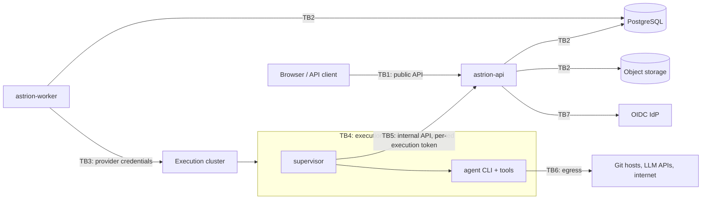

# Threat model

- Method: STRIDE per trust boundary, plus abuse cases specific to AI agents.
- Scope: Release 1 vertical slice (API, worker, supervisor, Kubernetes and
  local providers, web console).
- Last reviewed: 2026-10-10.
- Status legend: ✅ implemented and tested · 🟡 partial · 📋 planned (with target release).

Review this document whenever a trust boundary, credential flow, or
external integration changes.

## 1. What we protect

| Asset | Why it matters |
|---|---|
| Source code in customer repositories | Confidential IP; write access can ship malicious code |
| Repository, cloud, and agent credentials | Lateral movement to GitHub/GitLab, AWS, LLM vendors |
| Per-execution tokens | Can report status, upload artifacts, and raise questions for one execution |
| User identity tokens (OIDC) | Act as a user across the platform |
| Job inputs, specs, artifacts, logs | May contain business-sensitive data |
| Approval decisions and audit trail | Accountability for production changes and external side effects |
| Tenant isolation | One tenant must never see or affect another |
| Platform availability and capacity | Costly compute, shared queues |

## 2. Trust boundaries

- **TB1** — users ↔ API. Authenticated by OIDC bearer token.
- **TB2** — control-plane services ↔ data stores. Network-private, with
  service credentials.
- **TB3** — worker ↔ execution clusters. Uses a provider service account
  scoped to one namespace.
- **TB4** — inside the execution environment. **Everything here is assumed
  hostile.** The agent runs arbitrary tools on untrusted repository content
  and prompt input.
- **TB5** — supervisor ↔ internal API. Uses the per-execution token.
- **TB6** — agent egress to Git hosts, LLM APIs, and package registries.
- **TB7** — API ↔ IdP (JWKS retrieval).

## 3. Threats and mitigations

### TB1 — Public API and web console

| STRIDE | Threat | Mitigation | Status |
|---|---|---|---|
| S | Forged or replayed user tokens | OIDC signature and JWKS verification; issuer/audience/expiry checks with 1-minute leeway | ✅ |
| S | Dev tokens used in production | Dev auth refused when `ASTRION_ENV=production` (startup failure) | ✅ |
| S | Token leakage via URLs (logs, history, Referer) | Tokens are accepted **only** in the `Authorization` header, SSE included; the console uses `fetch` for SSE; `Referrer-Policy: no-referrer` | ✅ |
| T | Mass assignment / unexpected fields | Strict JSON decoding (unknown fields rejected); body size limits (256 KiB jobs, 128 KiB responses) | ✅ |
| T | Command injection through inputs | Inputs validated against command schemas; values passed to agents as data files, never through a shell; responses treated as data | ✅ |
| T | Executing a different command than intended (casing) | Exact-casing lookup; near-miss gets a hint, never a match | ✅ |
| R | User denies submitting, cancelling, or approving | Append-only audit events with actor, action, target | 🟡 Append-only by code path (no UPDATE/DELETE). DB-level enforcement (revoked privileges, hash chain) 📋 R3 |
| I | Cross-tenant reads via guessed IDs | Every query is tenant-scoped; cross-tenant IDs return 404 | ✅ (tenant isolation tests) |
| I | Hidden or unapproved commands revealed | Visibility filter by permission and agent; casing hints only for visible commands | ✅ |
| I | Malicious artifact rendered in the console (XSS) | Artifacts served with `Content-Security-Policy: sandbox; default-src 'none'`, `nosniff`; inline only for text/JSON; console renders agent output as text | ✅ |
| I | Script injection in the console steals session token | Strict CSP on the SPA shell (`script-src 'self'`, no `unsafe-inline`); text-only rendering; token in `sessionStorage` (per tab) | ✅. HTTP-only cookie session with the OIDC login flow 📋 R2 |
| E | Privilege escalation via UI-only checks | Every handler authorizes server-side; UI hints come from the server's `actions` map | ✅ |
| E | Admin self-approving production or running delivery commands | Separation of duties: `platform_admin` has no execute, deploy, or Jira-write rights; production approvals require `approve:production` | ✅ |
| I | `/metrics` and `/readyz` are unauthenticated on the API port | Labels use route *patterns* only (no IDs, tenants, or user data) | 🟡. Serve on a separate internal port or block at ingress 📋 R1 hardening |
| D | Submission floods | Per-user submissions/minute and per-tenant queued-job limits (`429`); tenant concurrency cap (default 10) | ✅ |
| D | Many idle SSE connections | 2 s poll fallback, streams end at job completion; per-replica connection gauge | 🟡. Per-user stream caps 📋 R2 |
| — | Duplicate jobs from retries/double-clicks | `Idempotency-Key` with request hash; mismatched body → `409` | ✅ |

### TB2 — Data stores

| STRIDE | Threat | Mitigation | Status |
|---|---|---|---|
| I | Secrets at rest in the DB | No secret values stored. Repositories hold `credentialRef`. Execution tokens stored as SHA-256 hashes. Logs/events/audit redacted | ✅ |
| I | Artifact bucket exposure | Per-tenant key prefixes; downloads only via API with tenant checks; optional SSE (`ASTRION_S3_SSE`) | ✅. Per-tenant bucket policies and KMS keys 📋 R3 |
| T | Event or state tampering via dual writes | Transactional outbox; workflow is the single writer of job state; legal transitions enforced | ✅ |
| D | Unbounded growth (events, logs) | Log batching and line caps (8 KiB/line, 200 lines/batch) | 🟡. Retention pruning by `retentionDays` 📋 R3 |

### TB3 — Worker ↔ execution clusters

| STRIDE | Threat | Mitigation | Status |
|---|---|---|---|
| E | Over-privileged provider credentials | Provider uses a namespace-scoped service account (create/delete Jobs, Secrets; get Pods) | 🟡 Documented. RBAC manifests in Helm chart 📋 R1 hardening |
| I | Running confidential work on a public cluster | Pool selection by classification, network, and allow-lists; **no fallback** to less restricted pools | ✅ (`provider.Select` tests) |
| T | TLS bypass to the cluster API | `insecureSkipVerify` refused in production | ✅ |
| — | Orphaned environments keep running with credentials | Ownership labels; idempotent cleanup on every path; orphan reconciler every minute | ✅ (reconciler tests, cancel e2e) |

### TB4 — Inside the execution environment (hostile)

| STRIDE | Threat | Mitigation | Status |
|---|---|---|---|
| E | Container escape / node compromise | Non-root, read-only root FS, no privilege escalation, drop ALL capabilities, seccomp `RuntimeDefault`, no host network, no SA token automount, resource limits, `activeDeadlineSeconds` | ✅ (manifest tests) |
| E | Sandboxed runtime for stronger isolation | gVisor/Kata runtime class per pool | 📋 R3 |
| I | Agent exfiltrates repository credentials | Credentials delivered as files (not env/argv/URLs), read at use time by `GIT_ASKPASS`; never written to `.git/config`; Secret owned by the Job (GC on delete) | ✅ |
| I | Agent prints secrets into logs/artifacts | Redaction **inside** the environment: exact known-secret values + patterns (GitHub, GitLab, AWS, Anthropic, Slack, JWT, bearer headers) before anything leaves | ✅ (`[mock:secret-leak]` e2e) |
| I | Agent reads the execution token | Token passed to the supervisor only; stripped from the agent's environment, which is minimal (PATH, private HOME/TMP) | ✅ |
| T | Prompt injection from repository content makes the agent act maliciously | Treat agent output as untrusted: no auto-merge; `WRITE` commands push only to a working branch; external side effects (push, change requests, Jira, deploy) are separately permissioned and approval-gated | 🟡 Branch isolation and permissions ✅. Push and change-request steps with mandatory review 📋 R2 |
| T | Tampered runtime image | Images pinned per agent profile | 🟡. Signed images (cosign) and admission verification 📋 R2 |
| D | Crypto-mining / runaway processes | CPU/memory limits, deadlines, process-group kill on cancel | ✅ |

### TB5 — Supervisor ↔ internal execution API

| STRIDE | Threat | Mitigation | Status |
|---|---|---|---|
| S | Token used for another execution or tenant | Token bound to execution, job, and tenant; checked on every call | ✅ |
| E | Token used after the job ends | Expiry and **revocation at cleanup**; calls get `401`/`410` and the supervisor stops | ✅ |
| T | Supervisor forges job state | Supervisor only records facts; the workflow decides transitions | ✅ |
| D | Oversized uploads | Declared-size check, hard cap (`ASTRION_MAX_ARTIFACT_BYTES`, 50 MiB default), streamed hashing; object deleted if metadata write fails | ✅ |
| I | Internal API reachable from the internet | Served on the API but intended for cluster-internal routing only | 🟡. Separate listener/port + NetworkPolicy 📋 R1 hardening |

### TB6 — Agent egress

| Threat | Mitigation | Status |
|---|---|---|
| Data exfiltration to arbitrary hosts | Pods are labelled with a network profile for egress NetworkPolicies (Git hosts, LLM API, registries) | 🟡 Labels ✅. Default-deny NetworkPolicies in Helm chart 📋 R1 hardening |
| Malicious dependencies installed by the agent | Ephemeral environments; no persistence between jobs; private registry mirrors | 📋 R3 |

### TB7 — Identity provider

| Threat | Mitigation | Status |
|---|---|---|
| Stale roles after offboarding | Roles re-synchronized from IdP groups on each request; short token lifetimes at the IdP | ✅ |
| JWKS spoofing | JWKS fetched over HTTPS from configured issuer | ✅ |

## 4. AI-agent abuse cases

1. **"Approve your own change."** An agent raises an approval and then tries
   to answer it. Agents have no user identity. Responses require an
   authenticated user with the right role, and production approval requires
   `approve:production`. ✅
2. **Smuggling commands through answers.** A human answer such as
   `"; rm -rf /"` is validated against the interaction schema and delivered
   as data (a JSON file or stdin frame), never interpreted by a shell. ✅
3. **Claiming a resumed session that was actually lost.** The platform never
   claims restoration. A lost environment goes to `NEEDS_INTERVENTION`, and a
   retry is a fresh attempt. ✅
4. **Silent side effects.** Commands declare side effects (for example
   `EXTERNAL_TICKET`). These require separate permissions and, where the
   command says so, a platform approval gate before execution. ✅

## 5. Residual risks and follow-ups

| Risk | Owner | Target |
|---|---|---|
| Default-deny egress NetworkPolicies and a separate internal-API listener are not yet shipped | Platform | R1 hardening (with Helm chart) |
| Signed runtime images and admission verification | Platform | R2 |
| DB-enforced append-only audit (privileges + hash chain) | Platform | R3 |
| Stronger sandboxing (gVisor/Kata) for untrusted repositories | Platform | R3 |
| Real agent adapters (Claude Code, Copilot CLI) need per-version output contract tests | Agents | R2 |
| `local` provider has no isolation | — | Accepted for dev only; refused in production |
